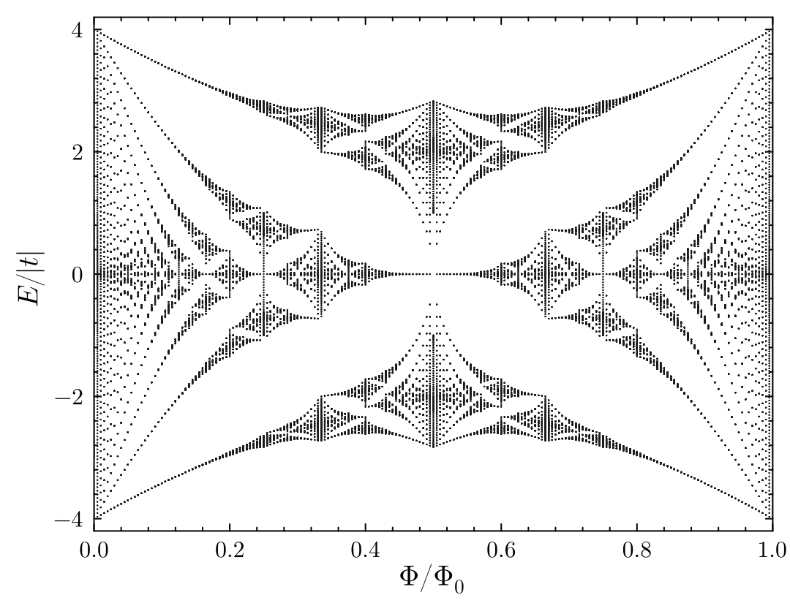
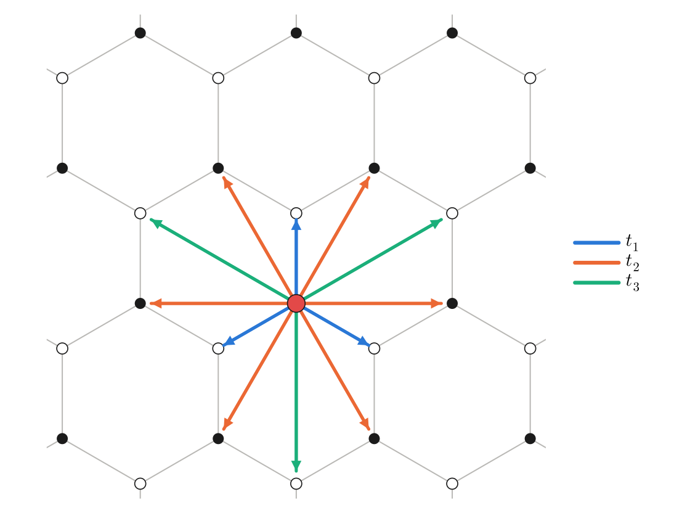
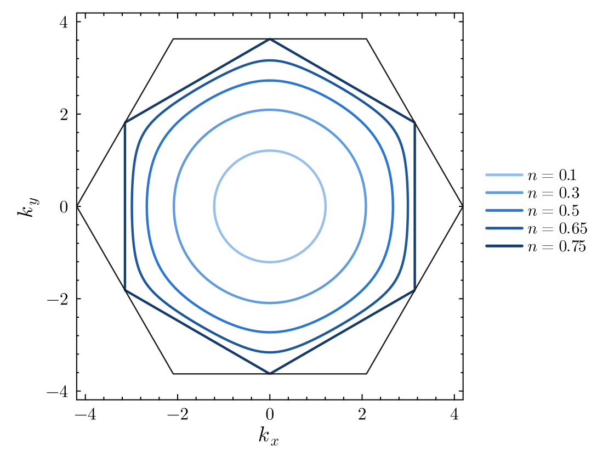
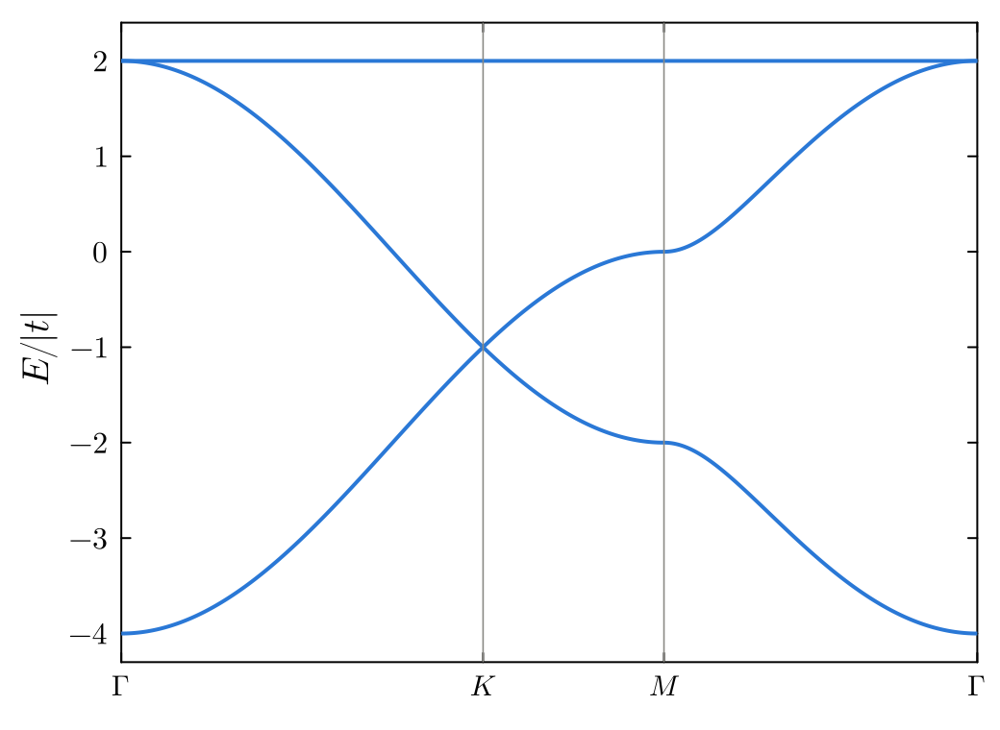
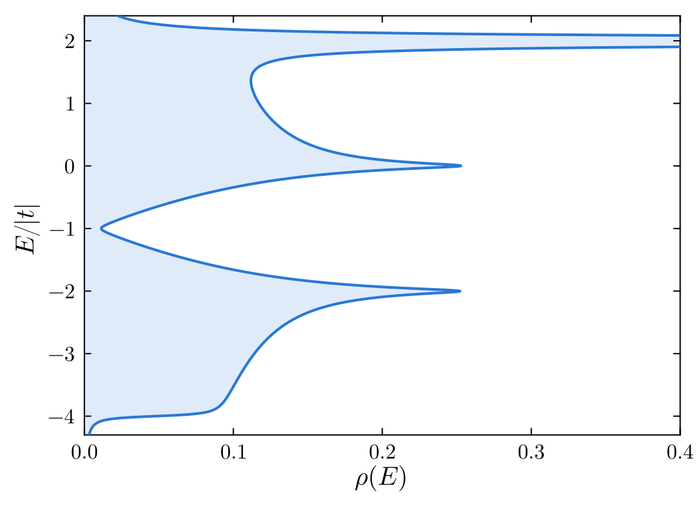
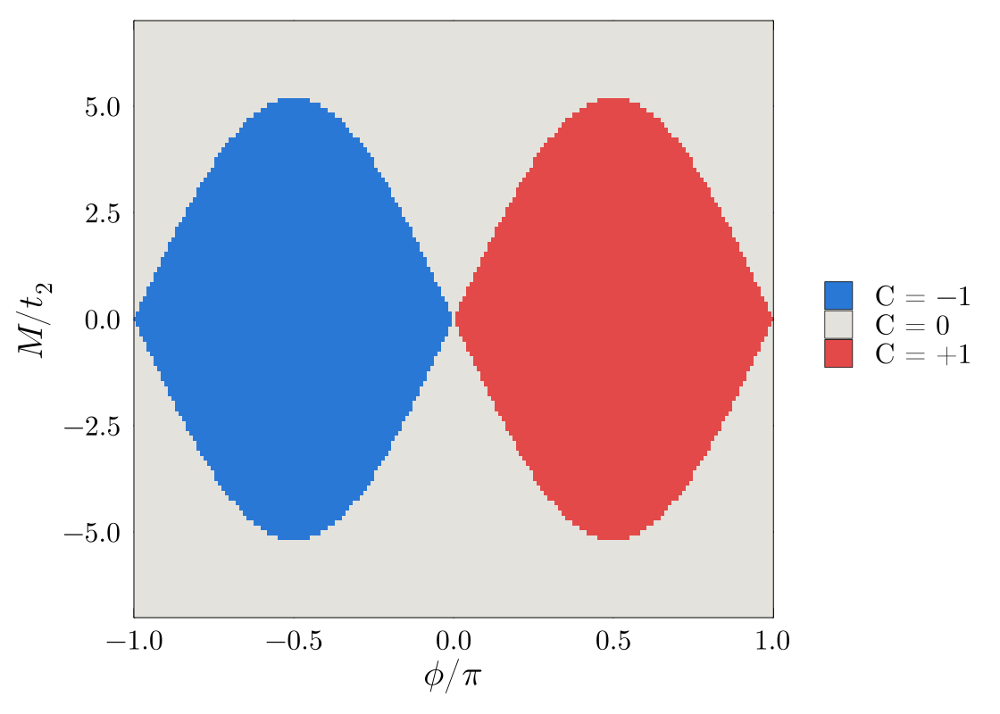
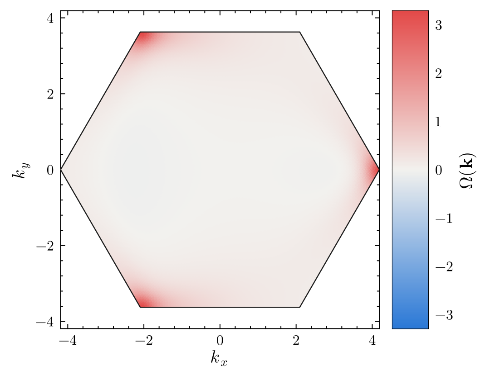
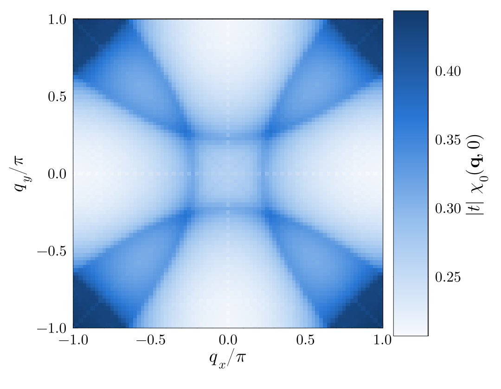

# TightBindingToolkit.jl

[](https://github.com/Toronto-Condensed-Matter-Theory/TightBindingToolkit.jl/actions/workflows/CI.yml?query=branch%3Amain)
[](https://Toronto-Condensed-Matter-Theory.github.io/TightBindingToolkit.jl/dev/)
[](LICENSE)

TightBindingToolkit.jl builds generic tight-binding models and computes their properties.
It handles any lattice in one, two or three dimensions, any user-defined bonds on that lattice, and particles of any spin.
Models can be solved in momentum space or on a finite real-space lattice, and superconducting (BdG) models are supported throughout.

<p align="center">
  
</p>

## Installation

TightBindingToolkit is registered in the General registry.
In the Julia REPL, press `]` to enter package mode and run

```julia
add TightBindingToolkit
```

or, equivalently,

```julia
using Pkg
Pkg.add("TightBindingToolkit")
```

## Quick start

Graphene at half filling:

```julia
using TightBindingToolkit

##### Honeycomb lattice of spin-1/2 electrons with nearest-neighbour hopping t = -1
uc = UnitCell([[1/2, sqrt(3)/2], [-1/2, sqrt(3)/2]], 2)    # primitive vectors, localDim = 2
AddBasisSite!(uc, [0.0, 0.0])
AddBasisSite!(uc, [0.0, 1/sqrt(3)])
AddIsotropicBonds!(uc, 1/sqrt(3), -1.0 * SpinMats(1//2)[4], "t1")   # every bond of length 1/√3

bz = BZ([6 * 20 + 3, 6 * 20 + 3])     # a 6n + 3 grid contains the K and M points
FillBZ!(bz, uc)

H = Hamiltonian(uc, bz)
DiagonalizeHamiltonian!(H)

model = Model(uc, bz, H ; filling = 0.5, T = 0.001)
SolveModel!(model)
model.mu        # ≈ 0: the Fermi level sits at the Dirac points
```

## Features

* **Unit cells** in $d = 1, 2, 3$ with any number of sublattices and any bonds, added by distance (`AddIsotropicBonds!`) or one at a time (`AddAnisotropicBond!`). Primitive vectors can be changed and unit cells enlarged on the fly.
* **Brillouin zones** on Monkhorst–Pack grids, with high-symmetry points and paths between them.
* **Hamiltonians** in momentum space, for normal and BdG (Nambu) systems. The Bloch Hamiltonian is built once in a k-independent form and evaluated quickly at every momentum.
* **Band structures, wavefunctions and densities of states.**
* **Filling the model** at a given chemical potential or filling, at any temperature, with band gaps, free energies and entropies, for normal and BdG systems.
* **Correlation functions** in momentum and real space.
* **Fermi surfaces** of any two-dimensional model.
* **Band topology and geometry:** Berry curvature, Chern numbers (from link variables or the Kubo formula) and the quantum geometric tensor, including for topological superconductors.
* **Response functions:** spin and charge susceptibilities at any momentum and frequency, with an RPA step, and the electrical conductivity.
* **Real-space lattices** of any size with periodic, antiperiodic, twisted or open boundary conditions; magnetic fields through Landau or symmetric gauges, flux insertion and plaquette fluxes.
* **Plotting helpers** for unit cells, lattices, band structures and Fermi surfaces.

## Gallery

<table>
<tr>
<td width="50%"><br><em>Honeycomb lattice with first-, second- and third-neighbour bonds leaving one site.</em></td>
<td width="50%"><br><em>Fermi surfaces of the triangular lattice; at n = 3/4 the surface is the nested hexagon through the M points.</em></td>
</tr>
<tr>
<td width="50%"><br><em>Kagome bands: a Dirac point at K and a flat band.</em></td>
<td width="50%"><br><em>Kagome density of states, with van Hove peaks and the flat-band peak (cut off).</em></td>
</tr>
<tr>
<td width="50%"><br><em>Chern number of the lower band of the spinless Haldane model, against the flux φ and the sublattice mass M.</em></td>
<td width="50%"><br><em>Berry curvature of the same band (C = 1), near the transition: it concentrates at the K′ points, where the gap is smallest.</em></td>
</tr>
<tr>
<td width="50%"><br><em>Static charge susceptibility χ₀(q) of the square lattice with t′ = −0.3t at filling 0.42.</em></td>
<td width="50%"><br><em>Hofstadter butterfly: spectrum of a real-space square lattice in the Landau gauge against the flux per plaquette.</em></td>
</tr>
</table>

Every figure is computed with the package. Regenerate them with `julia --project=docs/readme -t 8 docs/readme/figures.jl`.

## Examples

The [`Sample`](Sample) folder has standalone scripts: the square lattice, the honeycomb and triangular lattices with up to third-neighbour hopping, the Haldane model, the Kitaev chain, a Chern superconductor and a higher-order topological insulator.

## Documentation

See the [documentation](https://Toronto-Condensed-Matter-Theory.github.io/TightBindingToolkit.jl/dev/) for the full API.

## Related packages

| Package | Purpose |
|:--|:--|
| [TightBindingToolkit.jl](https://github.com/Toronto-Condensed-Matter-Theory/TightBindingToolkit.jl) | Lattices, tight-binding and BdG Hamiltonians, band structures and response |
| [FixedPointToolkit.jl](https://github.com/Toronto-Condensed-Matter-Theory/FixedPointToolkit.jl) | Fixed-point iteration and mixing schemes for self-consistent equations |
| [MeanFieldToolkit.jl](https://github.com/Toronto-Condensed-Matter-Theory/MeanFieldToolkit.jl) | Self-consistent mean-field theory of interacting lattice models |
| [RPAToolkit.jl](https://github.com/Toronto-Condensed-Matter-Theory/RPAToolkit.jl) | Random phase approximation: instabilities and collective modes |
